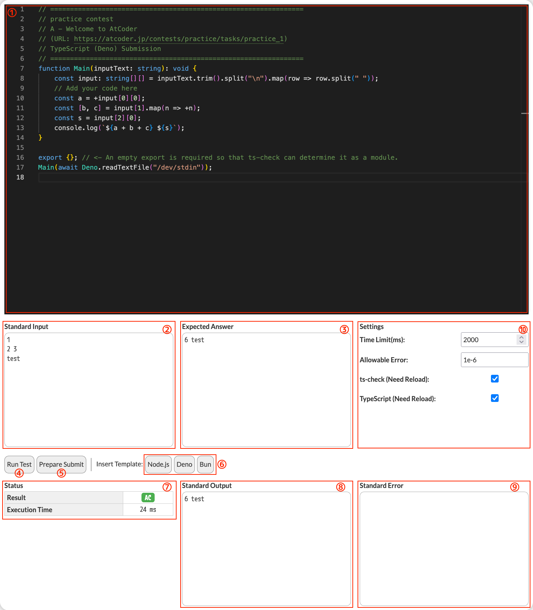

# AtCoder-JavaScript-Tester

AtCoderの問題ページで、JavaScript・TypeScriptのコードを編集・テスト実行・提出準備を行えるようにするユーザースクリプトです。

## ライセンス

copyright (c) 2025- Ayasaka-Koto
This project is licensed under [the MIT License](https://opensource.org/licenses/MIT).

## 特徴

1. 外部環境に依存しない、ブラウザ完結のコードテスト
    - JavaScriptコードを直接ブラウザ上(Web Worker)で実行するため、AtCoderのコードテストなどの外部環境に依存しません。
2. Monaco Editorによる高度なコード編集機能
    - Visual Studio Codeで使用されているMonaco Editorを組み込んでおり、Syntax HighlightやIntelliSenseなどの高度なコード編集機能が利用できます。
3. クリップボードへのコードコピーと提出準備
    - 編集したコードを問題ページ下部のソースコード入力欄に自動入力することができます。
4. 複数のランタイム環境に対応
    - Node.js, Deno, Bunの各ランタイム向けのコードテンプレートを提供しています。
5. TypeScript対応
    - TypeScriptでのコード編集・テスト実行もサポートしています。

## インストール方法

- [Greasy Fork](https://greasyfork.org/ja/scripts/554278-atcoder-javascript-tester)

Tampermonkeyなどのユーザースクリプトマネージャーを導入した状態で、上記リンクよりユーザースクリプトをインストールしてください。

## 使い方

AtCoderの問題ページにアクセスすると、問題文が画面左に寄り、右側にコードエディタとテスト実行用のUIが追加されます。

1. コードエディター
    - コードを編集できます。
    - Syntax HighlightやIntelliSenseなどが利用できます。
2. Standard Input (textarea)
    - コードに渡す標準入力をここに入力します。
    - 「入力例」をコピペするなどして利用してください。
    - 問題文の各入力例セクションに追加されてる[Copy IO]ボタンを押すと、自動でコピーされます。
3. Expected Output (textarea)
    - コードの実行結果と比較する期待される出力をここに入力します。
    - 「出力例」をコピペするなどして利用してください。
    - 問題文の各入力例セクションに追加されてる[Copy IO]ボタンを押すと、対応する出力例が自動でコピーされます。
4. \[Run Test\]ボタン
    - 入力された標準入力を使ってコードを実行し、出力結果を期待される出力と比較します。
    - 結果は画面下部に表示されます。
5. \[Prepare Submit\]ボタン
    - 編集したコードをクリップボードにコピーします。
    - また、ページ下部のソースコード入力欄までスクロールし、コードを自動でセットします。
6. \[Insert Template\]ボタン
    - Node.js, Deno, Bunの各ランタイム向けのコードテンプレートを挿入します。
    - このコードテンプレートを大きく逸脱したコードを書くと、テスト実行が正しく動作しない可能性があります
        - とくに、各テンプレートの最終行付近の`Main(...)`呼び出し部分は変更しないでください。
7. 実行結果表示エリア
    - Result: AtCoderに近い形で結果を表示します。(`AC`, `WA`, `TLE`など)
    - Execution Time: コードの実行時間をミリ秒単位で表示します。
8. Standard Output (textarea readonly)
    - コードの実行結果がここに表示されます。
9. Standard Error (textarea readonly)
    - コードの実行中に発生したエラーがここに表示されます。
    - なるべく詳細なエラー情報を表示するようにしていますが、一部情報が欠落する場合があります。
10. Settings
    - Time Limit (ms)
        - **コードの実行時間制限**をミリ秒単位で設定します。
        - 問題文に記載されている制限時間を自動反映する仕組みになっていますが、必要に応じて手動で変更できます。
    - Allowable Error
        - **浮動小数点数出力の許容誤差**を設定します。
        - 浮動小数点数を出力する問題の場合、ここで設定した誤差範囲内であれば正解とみなされます。
        - 浮動小数点数を出力しない問題の場合などではそのままで問題ありません。
    - ts-check (Need Reload)
        - **JavaScript + JSDocによる型チェック**を有効化します。
        - TypeScriptのように型チェックを行いたい場合に有効化してください。
        - 設定の切り替えは、ページのリロードを行うことで反映されます。
    - TypeScript (Need Reload)
        - **TypeScriptコードの編集・実行**を有効化します。
        - TypeScriptでコードを書きたい場合に有効化してください。
        - 設定の切り替えは、ページのリロードを行うことで反映されます。
        - この設定を有効化すると、以下の変化が発生することに留意してください。
            - コードテンプレートがTypeScriptのものに切り替わります。
            - Monaco Editorの言語モードがTypeScriptに切り替わります。
            - ts-check設定は無視され、型チェックが常に行われます。
            - \[Run Test\]時、Transpileが行われます。
                - TranspileにはSucraseを使用しているため、\[Run Test\]時には型チェックは行われません。
                - 型チェックの結果は、Monaco Editor上の表示を参照してください。
